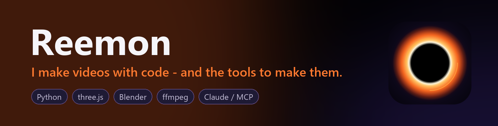

### Hi, I'm Reemon 👋

I make YouTube videos with code instead of editing software - motion graphics, explainers and music visuals - and I
build the tools that make that fast. Every frame is drawn on purpose, so a video comes out the same every time.

###  Shadow

**[Shadow](https://github.com/Reemon88IQ/shadow)** is a free Windows app that turns three.js / canvas HTML scenes and
Blender files into finished MP4 videos - 1080p, 30 fps, with sound, for YouTube (16:9) and Shorts (9:16) - with a quality
check on every video and a local Claude connection (MCP) that can render for you.

  

### 🧰 What I work with

`Python` · `three.js` · `WebGL` · `Blender` · `ffmpeg` · `Playwright` · `Claude` / `MCP` · `Inno Setup`

### 🔭 Right now

- Blender scenes and the Claude (MCP) connection in Shadow
- Audio-reactive music visuals and narrated diagram explainers, built from small configs instead of hand-made edits

Ideas or bugs for Shadow? <a href="https://github.com/Reemon88IQ/shadow/issues/new/choose">Open an issue</a>.
